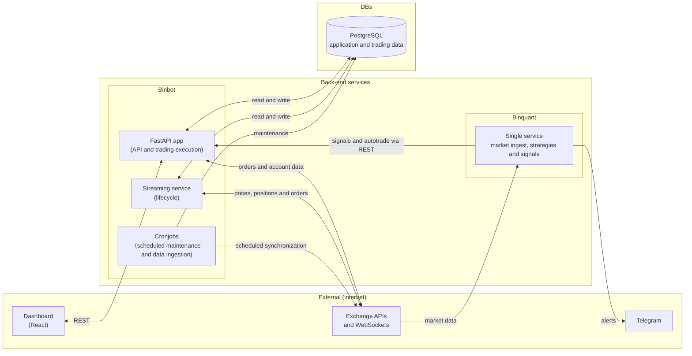

[](https://github.com/carkod/binbot/actions/workflows/pr.yml)

## Architecture



## Market analysis

See [market-wide CVD](docs/market-cvd.md) for the optional Dashboard chart and
independent collector, and [bot order book analysis](docs/bots/bot.md#order-book-analysis)
for the per-symbol bot-detail tab.

## Telegram alerts

Active futures bots send ephemeral Telegram alerts when last traded price reaches an
armed stop-loss or trailing-stop threshold. Each qualifying sweep attempts a
message before order reconciliation; completed bots do not notify. Messages
contain the bot name, symbol, stop type, threshold, and dashboard link. Delivery
does not confirm an exchange fill and is neither stored nor retried.

Set `TELEGRAM_BOT_KEY` and `TELEGRAM_USER_ID` in the streaming environment.
`TelegramDelivery` in pybinbot loads these from the application's `.env` during
initialization. Deploy pybinbot 1.13.7 with these changes; publish that release
and refresh the application lockfile before a registry-based deployment.

## KuCoin futures recovery

Futures bot stop-loss and trailing-stop orders, including recovery closes, and
grid protective stops use KuCoin's last traded price (`stopPriceType=TP`).
Pybinbot 2.1.2 defaults conditional futures orders to last price. Binbot also
passes the trigger type explicitly.
Streaming lifecycle decisions and stop alerts use the futures last-trade ticker
through Pybinbot's `KucoinFutures.get_ticker_price()` method, which validates the
exchange response. This application requires Pybinbot 2.1.2 or newer.
Trigger levels, limit prices, quantities, and market fallback rules are
unchanged. Existing exchange orders retain their trigger type until replaced.
Last price can spike more than mark price in either direction; selecting it does
not guarantee the highest long exit or lowest short exit, since fills depend on
the available order book.

Recovery is configured through `recovery_params`; `margin_short_reversal` has
been removed. After an entry fills, binbot arms a native conditional market
close for the current quantity with `reduceOnly=true`. KuCoin executes that
close independently of the worker. The worker reconciles order details and
historical fills before recording closure and creating one opposite pending
recovery bot. That bot enters through `open_deal()` / `base_order()` with a
separate order and cannot create another recovery child.

Conditional submissions never fall back to unconditional orders. Persisted
`clientOid` values recover ambiguous acknowledgements; order records keep the
requested quantity and trigger separate from executed quantity and price.
Source completion and creation of its uniquely linked recovery child commit
in one transaction. Manual/algorithmic closes cancel recovery eligibility.

Recovery and dynamic position sizing are mutually exclusive, including any
unsettled sizing order. Binquant configures `top_gainer_short` to use position
sizing with recovery disabled; the execution engine accepts recovery for any
strategy when sizing is disabled. Its trailing-deviation and six-hour crossing
exits remain in place.

Deploy the companion pybinbot changes with this application and binquant, and
apply migration `f6a81c2d490e` before starting the updated API/streaming workers.
The migration preserves existing recovery metadata, converts legacy flags, and
prioritizes position sizing when legacy configuration contains both modes.

# Development instructions

## Requirements

- Docker and docker-compose
- Python 3.11
- UV. If not installed, run `pip install uv`

## Run services

`docker compose up -d`

This should create and set up the Postgres database.

> Open source note:
> you'll need data for the entire project to work,
> which I do not provide

## Running back-end api

1. Run `uv sync` to activate the virtual environment
2. Comment out api service and `docker-compose up -d`
3. Run vscode debugger to start the FastAPI application

### Back-end api developer tooling

- For tests: `make test` or use `.vscode` folder config
- Install new dependencies with: `uv add <package-name>`
- Formatting with `make format`
- Upgrade pybinbot `make upgrade-pybinbot`

## Running front-end web app

1. Run `npm run install:clean`
2. Run `npm start`
3. Attach vscode debugger if needed

### Front-end tooling

- `npm run build` to test a production bundle locally
- `npm run test` to run unit tests
- `npm run format` to prettier format files, although this should be set up with the vscode prettier plugin

## Production deployment

Trigger manually the Github action `prod-deploy.yml`.
Each repo has its own, so cronjob, streaming and api is deployed using this Github action, binquant and the other repos should have their own independent deployment pipeline.

## API DB updates using Alembic

Use the `Makefile` to generate alembic migration scripts

### To remove a previously created migration

```
alembic stamp 113eb73ebba8
```

where 113eb73ebba8 is the supposed last "good" migration that you want to revert to.

## Manual Deployment

1. Merge changes to master
2. Test on local:

- `cd terminal && npm start`
- Build and test docker container `docker build --tag binbot . && docker run -ti -p 8000:80 binbot`
- Publish to docker hub `docker build --tag binbot . && docker tag binbot carloswufei/binbot:latest && docker push carloswufei/binbot`

3. Wait for check to pass. Github action will publish to Docker Hub

### Additional steps

If docker-compose doesn't exist: 3. Copy `scp docker-compose.yml <USERNAME>@<SERVER_IP>:/var/www/binbot.carloswu.com` 4. Modify details to match production needs

or `docker build --tag binbot . && docker tag binbot carloswufei/binbot:latest && docker push carloswufei/binbot`

In production: 5. `docker compose up --pull always -d` 6. If `.env.prod` is modified, scp to remote server and replace `.env` in production with new `.env.prod`

## Detailed documentation

https://carkod.github.io/binbot/
