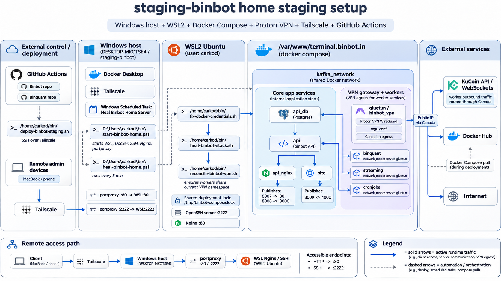

## Position lifecycle

Binquant owns trade entry decisions, while binbot's streaming service manages
open positions through shared and strategy-specific lifecycle policies. See
[Position lifecycle architecture](lifecycle.md) for the component flow,
strategy-matching contract, and extension guidelines.

## staging-binbot home staging infrastructure

`staging-binbot` runs on a Windows home server (`DESKTOP-MKOTSE4`) with Docker
Desktop and WSL2 Ubuntu. Tailscale provides remote administration and deployment
access, while Proton VPN provides Canadian internet egress for the worker
services. The diagram below describes the home deployment, whose Docker Compose
stack lives at `/var/www/terminal.binbot.in` inside WSL; the repository's local
`compose.yml` is a separate development configuration.

Solid blue arrows show runtime traffic, including remote access, service
communication, and VPN egress. Dashed grey arrows show deployment and recovery
automation, including image pulls.

### Host and remote access

Windows runs Docker Desktop and Tailscale. Remote devices join Tailscale and
reach the Windows host, which forwards TCP traffic into WSL using `portproxy`:

| Windows port | WSL destination | Purpose |
| --- | --- | --- |
| `80` | Nginx on port `80` | HTTP access to the staging applications. |
| `2222` | OpenSSH on port `2222` | SSH administration and automated deployment as `carkod`. |

The remote access path is client → Tailscale → Windows host → `portproxy` →
WSL Nginx or SSH. The terminal uses the same-origin `/api` base URL when opened
at `http://staging-binbot`, keeping dashboard requests on the HTTP access path.

### Compose services and VPN routing

The stack uses the shared Docker network `kafka_network`. Its core services are
`api_db` (PostgreSQL), `api` (the binbot FastAPI backend), `api_nginx` (the
dashboard and API proxy), and `site` (the brochure site). The API uses PostgreSQL
for application state, and the dashboard and brochure site consume the API.

| Service | Published port mapping | Purpose |
| --- | --- | --- |
| `api_nginx` | `8007:80` | Terminal dashboard. |
| `api_nginx` | `8008:8000` | API proxy. |
| `site` | `8009:4000` | Brochure site. |

These Compose ports are separate from the Windows-to-WSL forwarding above.
WSL Nginx provides the HTTP entry point on port `80`.

The `gluetun` service, shown as `gluetun / binbot_vpn`, runs Proton VPN WireGuard
using `wg0.conf` with Canadian egress. `binquant` (signals and bot updates),
`streaming` (open-position management), and `cronjobs` (scheduled work) each use
`network_mode: service:gluetun`. They share the VPN gateway's network namespace,
reach the API and database through the shared Docker network, and send outbound
KuCoin API, WebSocket, and other internet traffic through the Canadian public IP.

Docker Compose pulls deployment images from Docker Hub. This is a host-side
deployment operation, separate from the workers' VPN traffic.

### Deployment and automatic recovery

GitHub Actions in the binbot and binquant repositories deploy over Tailscale and
SSH through `/home/carkod/bin/deploy-binbot-staging.sh`. The binbot
[staging deployment job](../.github/workflows/deployments.yml) runs after its
service images have been built and pushed to Docker Hub, connects to Tailscale,
and invokes that script over SSH on port `2222`.

The home server also has a recovery chain spanning Windows and WSL:

| Script or task | Responsibility |
| --- | --- |
| `D:\Users\carkod\bin\start-binbot-home.ps1` | Starts WSL, Docker, SSH, Nginx, and port forwarding. |
| Windows scheduled task `Heal Binbot Home Server` | Runs `D:\Users\carkod\bin\heal-binbot-home.ps1` every five minutes. |
| `/home/carkod/bin/fix-docker-credentials.sh` | Repairs Docker credentials in WSL. |
| `/home/carkod/bin/heal-binbot-stack.sh` | Heals the Compose stack. |
| `/home/carkod/bin/reconcile-binbot-vpn.sh` | Ensures workers share the current VPN network namespace. |

The WSL recovery sequence runs credential repair, stack healing, then VPN
reconciliation. Deployment and recovery operations share
`/tmp/binbot-compose.lock` to serialize changes to the Compose stack. Reconciling
the workers with the current VPN namespace keeps their routing aligned after
the gateway is replaced.

## Database

The new PostgreSQL database introduced a new architecture to the whole API ecosystem. It is based on the [FastAPI full stack template](https://github.com/fastapi/full-stack-fastapi-template).

API layer is now separated from databases. On one hand this is to allow the possibility in the future to release staggered API versions that can work independently. E.g. /api/api_v1 /api/api_v2...

On the other hand, the data provided by the Rest API does not have to correspond 1to1 to the data in the Database. At this stage, 2 databases are used, the MongoDB instance serves Big data, that most of the time its unstructure, like candlesticks, because these are indexed by timestamp. However the SQL database is structure data that has matured and is consumed by applications that require performance and a structure.

This separation gives us the flexibility to release API changes independently of what database source we use.

### PostgreSQL table relationships

This diagram covers the 19 application tables in the current SQLModel schema and
Alembic's `alembic_version` table. It shows key columns only. A line represents a
declared foreign key; `o` means the relationship is optional and a crow's foot
means many rows are allowed.

The two links between `bot` and `recovery_bot_table` use different foreign keys:
`bot.recovery_mode_id` points to its recovery parameters, while
`recovery_bot_table.source_bot_id` points back to a source bot. Both columns are
nullable and unique. `bot.deal_id` is nullable but is **not** unique in the
database, even though the ORM treats the deal as a single object. Symbols in
signals, bots, grid ladders, and market samples are strings, not foreign keys to
`symbol`. Likewise, `grid_order.exchange_order_id` is an exchange identifier,
not a foreign key to `exchange_order`.

### Table usage and cleanup

Across the current API, streaming service, cron jobs, terminal, brochure site,
and shared `pybinbot` client, every application table has an active code path:

| Tables | Current use |
| --- | --- |
| `bot`, `deal`, `exchange_order`, `recovery_bot_table`, `signals` | Trading state, orders, recovery, and signal history. |
| `grid_ladder`, `grid_level`, `grid_order` | Grid trading lifecycle and order tracking. |
| `symbol`, `symbol_exchange`, `autotrade` | Exchange symbol metadata and trading settings. |
| `consolidated_balances`, `balances` | Scheduled balance snapshots and portfolio history. |
| `market_breadth`, `top_gainers_losers_series`, `futures_price_sample` | Market breadth for binquant strategies; hourly ranking timestamps and full registered-futures price snapshots for the dashboard's seven-day gain/loss trend; price samples also support fastest movers. |
| `binbot_user`, `inquirytable`, `web3_candidates` | Authentication, brochure site contact inquiries, and scheduled Web3 candidate ingestion/API. |
| `alembic_version` | Alembic migration state; it must be retained. |

No current table is a safe deletion candidate based on code usage alone. Older
tables for paper trading (`paper_trading`, `fake_order`, `test_autotrade`), staging
balances (`staging_balances`, `staging_consolidated_balances`), and asset indexes
(`asset_index`, `symbol_index_link`) already have removal migrations. The former
`top_gainers_losers` table was renamed to `top_gainers_losers_series`.

This is a source-code audit, not a live database inventory: the configured
PostgreSQL instance was unreachable during this review. Before removing a table
from any deployment, compare its actual tables, row counts, dependencies, and
Alembic revision with this schema.
