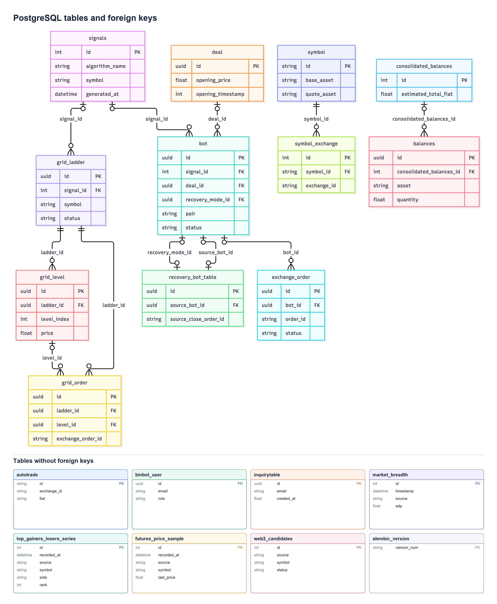

## Position lifecycle

Binquant owns trade entry decisions, while binbot's streaming service manages
open positions through shared and strategy-specific lifecycle policies. See
[Position lifecycle architecture](lifecycle.md) for the component flow,
strategy-matching contract, and extension guidelines.

## Database

The new PostgreSQL database introduced a new architecture to the whole API ecosystem. It is based on the [FastAPI full stack template](https://github.com/fastapi/full-stack-fastapi-template).

API layer is now separated from databases. On one hand this is to allow the possibility in the future to release staggered API versions that can work independently. E.g. /api/api_v1 /api/api_v2...

On the other hand, the data provided by the Rest API does not have to correspond 1to1 to the data in the Database. At this stage, 2 databases are used, the MongoDB instance serves Big data, that most of the time its unstructure, like candlesticks, because these are indexed by timestamp. However the SQL database is structure data that has matured and is consumed by applications that require performance and a structure.

This separation gives us the flexibility to release API changes independently of what database source we use.

### PostgreSQL table relationships

This diagram covers the 19 application tables in the current SQLModel schema and
Alembic's `alembic_version` table. It shows key columns only. A line represents a
declared foreign key; `o` means the relationship is optional and a crow's foot
means many rows are allowed.

The two links between `bot` and `recovery_bot_table` use different foreign keys:
`bot.recovery_mode_id` points to its recovery parameters, while
`recovery_bot_table.source_bot_id` points back to a source bot. Both columns are
nullable and unique. `bot.deal_id` is nullable but is **not** unique in the
database, even though the ORM treats the deal as a single object. Symbols in
signals, bots, grid ladders, and market samples are strings, not foreign keys to
`symbol`. Likewise, `grid_order.exchange_order_id` is an exchange identifier,
not a foreign key to `exchange_order`.

### Table usage and cleanup

Across the current API, streaming service, cron jobs, terminal, brochure site,
and shared `pybinbot` client, every application table has an active code path:

| Tables | Current use |
| --- | --- |
| `bot`, `deal`, `exchange_order`, `recovery_bot_table`, `signals` | Trading state, orders, recovery, and signal history. |
| `grid_ladder`, `grid_level`, `grid_order` | Grid trading lifecycle and order tracking. |
| `symbol`, `symbol_exchange`, `autotrade` | Exchange symbol metadata and trading settings. |
| `consolidated_balances`, `balances` | Scheduled balance snapshots and portfolio history. |
| `market_breadth`, `top_gainers_losers_series`, `futures_price_sample` | Market breadth for binquant strategies; hourly ranking timestamps and full registered-futures price snapshots for the dashboard's seven-day gain/loss trend; price samples also support fastest movers. |
| `binbot_user`, `inquirytable`, `web3_candidates` | Authentication, brochure site contact inquiries, and scheduled Web3 candidate ingestion/API. |
| `alembic_version` | Alembic migration state; it must be retained. |

No current table is a safe deletion candidate based on code usage alone. Older
tables for paper trading (`paper_trading`, `fake_order`, `test_autotrade`), staging
balances (`staging_balances`, `staging_consolidated_balances`), and asset indexes
(`asset_index`, `symbol_index_link`) already have removal migrations. The former
`top_gainers_losers` table was renamed to `top_gainers_losers_series`.

This is a source-code audit, not a live database inventory: the configured
PostgreSQL instance was unreachable during this review. Before removing a table
from any deployment, compare its actual tables, row counts, dependencies, and
Alembic revision with this schema.
